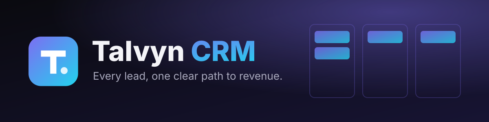
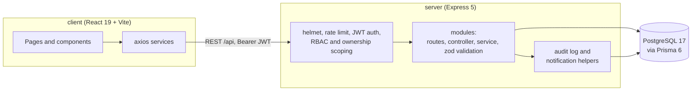

<div align="center">



<br />


# Talvyn CRM

**Every lead, one clear path to revenue.**

A role-based sales CRM: convert leads in one click, run your pipeline on a drag-and-drop board, and keep every follow-up, task and change on the record.


</div>

---

## Features

| | |
|---|---|
| **Lead to revenue** | Convert a lead into a deduplicated customer plus an opportunity in one transaction; the original lead is kept as an audit trail. Concurrent conversions are guarded. |
| **Drag-and-drop pipeline** | `@dnd-kit` kanban across 7 stages with optimistic updates, plus a "Move to stage" select for keyboard and touch users. |
| **Follow-ups and tasks** | Schedule, assign and complete work linked to a lead, customer or opportunity. |
| **Call logs** | Record call outcomes against a record (API complete; UI still to come). |
| **Notifications** | Bell with persisted alerts plus computed overdue-task and upcoming-follow-up reminders. |
| **Audit log** | Admin-only history of who changed what and when; secrets such as passwords are redacted. |
| **Role-based access** | Admin, Sales Manager and Sales Executive, enforced with row-level ownership scoping in every query. |
| **Live dashboard** | Revenue trend, pipeline funnel, rep performance and upcoming follow-ups (Recharts). |
| **Accessible, responsive UI** | Skip link, per-page titles, focus-trapped modals, 44px touch targets, stacked-card tables on phones, `prefers-reduced-motion`. |

## Screenshots

> Screenshots and a short demo GIF are not included yet. Add them under `docs/assets/screenshots/` using seeded demo data only, then link them here.

| Dashboard | Pipeline |
|---|---|
| _placeholder_ | _placeholder_ |

## Architecture



Monorepo layout:

```
client/   React app (pages, components, services, hand-written CSS design tokens)
server/   Express API (src/modules/<domain>), Prisma schema and migrations, tests
docs/     Architecture, API reference, decisions, testing, QA report, brand assets
```

## Quick start

Requirements: Node.js 20+, pnpm 10+, a local PostgreSQL.

```bash
pnpm install
cp server/.env.example server/.env   # fill in DATABASE_URL and JWT_SECRET
pnpm prisma:migrate
pnpm prisma:seed                      # demo users; see server/prisma/seed.js
pnpm dev                              # API on :5000, client on :5173
```

Demo logins come from [`server/prisma/seed.js`](server/prisma/seed.js). They are for local development only; never seed them into a shared or production database.

## Configuration

`server/.env` (see [`server/.env.example`](server/.env.example)):

| Variable | Required | Default | Purpose |
|---|---|---|---|
| `DATABASE_URL` | yes | none | PostgreSQL connection string |
| `JWT_SECRET` | yes | none | JWT signing secret, at least 16 characters |
| `JWT_EXPIRES_IN` | no | `7d` | Token lifetime |
| `PORT` | no | `5000` | API port |
| `CLIENT_URL` | no | `http://localhost:5173` | Allowed CORS origin |
| `ALLOW_REGISTRATION` | no | `true` | Set `false` to disable open sign-up |
| `TRUST_PROXY` | no | off | Proxy hop count, so rate limiting sees real client IPs |
| `NODE_ENV` | no | none | `production` enables combined logging; `test` disables rate limits |

The client dev server reads optional `CLIENT_PORT` and `API_PORT` overrides (defaults 5173 and 5000).

## API overview

All routes live under `/api` and need `Authorization: Bearer <token>` except auth and health.

| Area | Routes |
|---|---|
| Auth | `POST /auth/register`, `POST /auth/login`, `GET /auth/me` |
| Users (admin) | `/users` |
| Leads | `/leads`, `POST /leads/:id/convert` |
| Customers | `/customers` |
| Opportunities | `/opportunities`, `PATCH /opportunities/:id/stage` |
| Follow-ups, tasks, call logs | `/followups`, `/tasks`, `/call-logs` |
| Notifications | `/notifications`, `PATCH /notifications/read-all` |
| Audit logs (admin) | `/audit-logs` |
| Dashboard | `/dashboard/*` |

Full reference: [`docs/API_DOCUMENTATION.md`](docs/API_DOCUMENTATION.md).

## Testing

```bash
pnpm --filter server test                      # unit and HTTP tests (node:test), no database needed
RUN_DB_TESTS=1 pnpm --filter server test       # adds DB-backed regression tests; use a disposable database
pnpm --filter client lint
pnpm --filter client build
```

CI runs lint, build and the server tests on every pull request. The DB suite is not in CI yet. Strategy and manual QA notes: [`docs/TESTING.md`](docs/TESTING.md), [`docs/QA-REPORT.md`](docs/QA-REPORT.md).

## Security notes

Implemented: bcrypt password hashing, JWT re-validated against the database on each request, helmet, 100kb body limit, auth rate limiting, password policy, last-admin protection, row-level ownership checks, audit log with secret redaction, required secrets at startup.

Known limitations (open items from the [QA report](docs/QA-REPORT.md)):

- The JWT is kept in `localStorage` with a 7-day lifetime and no revocation.
- Open registration can reveal whether an email exists; use `ALLOW_REGISTRATION=false` for closed deployments.
- The rate-limit store is in memory, so it is per instance.
- The pipeline board and pickers are capped at 100 rows; search has no trigram indexes.
- Audit writes happen outside the business transaction by design.
- No call-log UI yet, and the dashboard chart bundle is large.

Report vulnerabilities privately through GitHub's "Report a vulnerability" on the Security tab.

## Roadmap

- Call-log UI and report export (PDF/Excel)
- httpOnly-cookie sessions with refresh tokens, or invite-only sign-up
- Shared rate-limit store (Redis) and pagination for large pipelines
- Client tests and DB tests in CI; light theme

See [`docs/FUTURE_FEATURES.md`](docs/FUTURE_FEATURES.md) and [`docs/TECHNICAL_DEBT.md`](docs/TECHNICAL_DEBT.md).

## Documentation

Start at [`docs/README.md`](docs/README.md): architecture, database, API, decisions, style guide, testing, QA report and changelog.

## License

[MIT](LICENSE)
